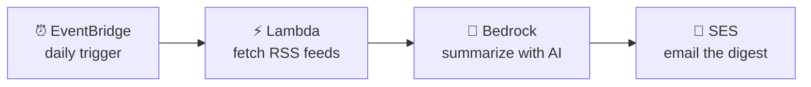
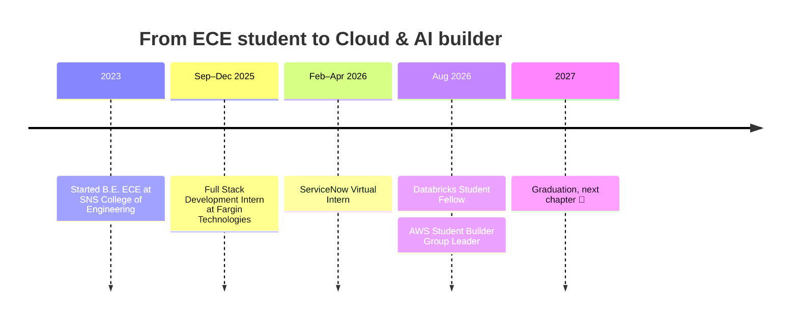

<table align="center">
<tr>
<td align="center" width="260">

<!-- 📸 To use your own photo: upload it to this repo as assets/profile.jpg and replace the URL below with:
     https://wsrv.nl/?url=raw.githubusercontent.com/Sankar2316/Sankar2316/main/assets/profile.jpg&w=220&h=220&fit=cover&mask=circle -->


### Sankar ☁️
**AWS SBGL @SNSCE | Databricks Student Fellow @Databricks | SDE | Cloud & DevOps | AI Developer |  Ex Intern @ServiceNow**

📍 Tamil Nadu, India

</td>
<td>
<div align="center">
  
</div>

## I turn **ideas into serverless, AI-powered apps** on AWS ☁️

### Final-year ECE student · **Databricks Student Fellow** · Helping **100+ students** earn their first AWS certification
[](https://www.linkedin.com/in/YOUR-LINKEDIN-ID)
[](mailto:sankarsaravanakumar2316@gmail.com)
[](https://YOUR-PORTFOLIO-URL)


</td>
</tr>
</table>

<div align="center">


</div>

## 💻 `Who Am I?`

```bash
$ cat sankar.yaml

name:        Sankar Saravanakumar
education:   B.E. ECE (2023–2027) @ SNS College of Engineering
roles:       [Databricks Student Fellow, AWS Student Builder Group Leader, Placement Coordinator]
building:    [AI DSA Recommender, SOP Proctored Exam Portal, Daily Tech Digest Agent]
exploring:   [Agentic AI, LLM Orchestration, MLOps, Cloud-Native DevOps]
superpower:  Turning a rough idea into a deployed serverless app ⚡
```

## 🛠️ Tech Stack

| Category | Technologies |
|:---|:---|
| **Languages** |      |
| **Cloud & Data** |     |
| **AI & GenAI** |     |
| **Web & Backend** |      |
| **Databases** |    |
| **DevOps & Tools** |        |


## 🚀 Featured Projects

A collection of hands-on projects focused on **Cloud Computing, Generative AI, Serverless Architecture, and Intelligent Automation.**

<table>
<tr>
<td width="50%" valign="top">
<h3>🏛️ GovEase</h3>
<p>AI-powered platform that helps users discover government schemes based on their eligibility, with intelligent recommendations.</p>
<strong>Tech Stack</strong><br/>
<code>AWS Lambda</code> <code>API Gateway</code> <code>DynamoDB</code> <code>Amazon Bedrock</code>
<br/><br/>
<a href="https://github.com/Sankar2316/govease">View Repository →</a>
</td>
<td width="50%" valign="top">
<h3>🤖 AI DSA Recommender</h3>
<p>Analyzes coding weaknesses across DSA topics and recommends personalized daily practice problems.</p>
<strong>Tech Stack</strong><br/>
<code>Amazon Bedrock</code> <code>Lambda</code> <code>DynamoDB</code> <code>S3</code>
<br/><br/>
<a href="https://github.com/Sankar2316?tab=repositories">View Repository →</a>
</td>
</tr>
<tr>
<td width="50%" valign="top">
<h3>📰 Daily Tech Digest Agent</h3>
<p>A serverless AI agent that collects RSS feeds, generates intelligent summaries, and delivers daily email digests.</p>
<strong>Tech Stack</strong><br/>
<code>EventBridge</code> <code>Lambda</code> <code>Bedrock</code> <code>SES</code>
<br/><br/>
<a href="https://github.com/Sankar2316/daily-tech-digest-agent">View Repository →</a>
</td>
<td width="50%" valign="top">
<h3>📊 Smart Priority</h3>
<p>AI-powered task management application that intelligently analyzes and prioritizes tasks using a cloud-native architecture.</p>
<strong>Tech Stack</strong><br/>
<code>AWS Amplify</code> <code>Lambda</code> <code>DynamoDB</code> <code>Bedrock</code>
<br/><br/>
<a href="https://github.com/Sankar2316/smart-priority">View Repository →</a>
</td>
</tr>
<tr>
<td width="50%" valign="top">
<h3>💰 Expense Sorter</h3>
<p>Automates receipt processing, extracts transaction details, and categorizes expenses using AI.</p>
<strong>Tech Stack</strong><br/>
<code>Amazon Textract</code> <code>Bedrock</code> <code>S3</code>
<br/><br/>
<a href="https://github.com/Sankar2316?tab=repositories">View Repository →</a>
</td>
<td width="50%" valign="top">
<h3>🧠 AI Resume Analyzer</h3>
<p>Analyzes resumes, extracts relevant skills, and provides AI-assisted feedback for career improvement.</p>
<strong>Tech Stack</strong><br/>
<code>Python</code> <code>Streamlit</code> <code>Snowflake</code>
<br/><br/>
<a href="https://github.com/Sankar2316?tab=repositories">View Repository →</a>
</td>
</tr>
<tr>
<td width="50%" valign="top">
<h3>🎮 Trivia MCP Server</h3>
<p>An MCP server integrating Open Trivia DB to provide access to 4,000+ trivia questions through AI-compatible tools.</p>
<strong>Tech Stack</strong><br/>
<code>TypeScript</code> <code>MCP SDK</code>
<br/><br/>
<a href="https://github.com/Sankar2316/trivia-mcp-server">View Repository →</a>
</td>
<td width="50%" valign="top">
<h3>🎯 SOP Proctored Exam Portal</h3>
<p>A secure online examination platform with AI-powered monitoring capabilities.</p>
<strong>Tech Stack</strong><br/>
<code>Node.js</code> <code>React</code> <code>AWS</code>
<br/><br/>
<a href="https://github.com/Sankar2316?tab=repositories">View Repository →</a>
</td>
</tr>
</table>

<p align="center">
  <b>Building | Experimenting | Innovating</b><br/>
  <i>Turning ideas into practical Cloud & AI solutions.</i>
</p>

<sub>More on my [repositories page](https://github.com/Sankar2316?tab=repositories): URL Shortener, NASA APOD MCP Server, Pokémon MCP Server, WiFi People Monitoring, Landing Page Generator.</sub>

### ⚡ How my Daily Tech Digest Agent works



---

## 🏆 Certifications

**☁️ AWS (5x Certified)**


**🌐 Others**


## 🗺️ My Journey



## 🤝 Community & Leadership

| Role | Organization | Period |
| --- | --- | --- |
| 🎓 **Databricks Student Fellow** | Databricks | Aug 2026 – Present |
| 👥 **AWS Student Builder Group Leader** | Amazon Web Services · SNS College of Engineering | Aug 2026 – Present |
| 📋 **Student Placement Coordinator** | SNS College of Engineering | 2026 – Present |
| 🤝 **Organizing Team Member** | AWS User Group Madurai | Active |

## 📊 GitHub Stats

<div align="center">

  

  

  <br/>

  

</div>


### 💬 Let's build something together

Got an idea around **cloud, AI or serverless**? Ping me. I'm always up for a good collab. ⭐ Star a repo if you like what you see!

[](https://www.linkedin.com/in/YOUR-LINKEDIN-ID)
[](mailto:sankarsaravanakumar2316@gmail.com)

</div>


